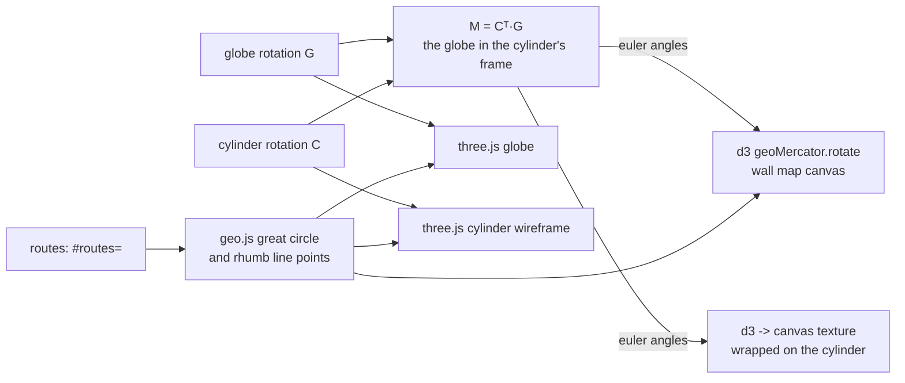

# How Mercator Lab is built

A static site: one HTML page, CSS and classic script files, no framework, no bundler. The 3D view is three.js
(WebGL); the wall map is d3 drawing to a 2D canvas. All data (country shapes, cities) is inlined, so nothing is
fetched after the page loads. About 1,100 lines of app code plus ~300 KB of inlined data, and 400 lines of tests.

## Runtime

| Piece | What it uses |
|---|---|
| 3D globe and cylinder | **three.js** r128 (WebGL): meshes, line segments, `CanvasTexture`, raycasting for clicks |
| Wall map and textures | **d3** 7.9.0: `geoMercator` with a rotation, `geoPath` drawn to canvas |
| Country shapes | **topojson-client** 3.0.2; Natural Earth 110m (world-atlas), inlined in `world.js` |
| Cities | GeoNames cities of 100,000+ (CC BY 4.0), inlined in `places.js` |
| State | Routes in the URL hash (`#routes=lon,lat,lon,lat;…`) |
| Libraries | three.js, d3 and topojson from cdnjs, pinned |

Dev only: Node's built-in test runner (unit tests), Playwright + axe-core (browser and accessibility tests).

## Files

```
index.html     the page: 3D view and wall map side by side, side panel
app.js         the app: three.js scene, map texture, wall map, routes, dragging, animation, controls
geo.js         pure: great-circle and rhumb-line math, distances, coordinate parsing, formatting
sphere.js      pure: rotation matrices, the Mercator cylinder, where it touches the globe (touchLabel)
lines.js       pure: routes to and from the URL (old #lines= links too)
search.js      the From and To boxes (city search and typed coordinates)
cities.js      labeled cities and the zoom level each appears at; cityAt names a point
places.js      the search list (GeoNames), world.js the country shapes (both data)
help.html      the guide; unroll/ redirects old links
tests/, e2e/   unit tests (geo, sphere, lines, search) and browser tests (desktop + phone, axe)
```

## How it fits together



## Core techniques

- **One matrix decides the map.** The globe has an orientation G and the cylinder an orientation C (3×3
  rotation matrices). What the cylinder "sees" is the globe in the cylinder's frame, M = Cᵀ·G. Turning the globe
  or the cylinder changes M; the wall map is d3's Mercator rotated by M's Euler angles, so it redraws live.
  Normal, transverse and oblique presets, and "Cylinder along this route", are just target values of C.
- **The map on the cylinder.** The same rotated Mercator is drawn with d3 into an offscreen canvas, used as a
  three.js `CanvasTexture` on a cylinder mesh whose vertices are placed in the cylinder's frame. Redraws are
  throttled to about 8 a second while dragging. The opacity slider fades only this fill; the wireframe, country
  outlines and routes on the cylinder stay.
- **Routes two ways.** A great circle (shortest path, slerp between the endpoints' unit vectors) and a rhumb line
  (constant bearing, a straight line on any normal Mercator) are computed in `geo.js` and drawn on the globe, the
  cylinder and the wall map.
- **Smooth turns.** Animations interpolate rotations as quaternions (slerp), so presets turn the short way round
  without gimbal flips.
- **Frames.** `sphere.js` uses d3's geographic Cartesian frame (x → 0°,0°; z → North Pole); three.js is y-up, so
  coordinates are cyclically permuted (x,y,z → y,z,x), which keeps handedness and rotation directions.
- **Draw only when something changed.** A dirty flag gates rendering; the wall map is keyed on M, the routes and
  its size. Tests wait on an "idle" hook rather than sleeping.

## Testing and deploy

- `npm test`: Node's test runner on the pure files: distances against known values, rhumb vs great-circle
  lengths, coordinate parsing, rotations and the touch-circle labels, route encoding.
- `npm run test:e2e`: Playwright at desktop and phone size: dragging, presets, routes on both views, clicking the
  wall map, the URL round-trip, and axe accessibility checks.
- Pushing to `main` runs both in GitHub Actions (the shared workflow in
  [csciuto/app-template](https://github.com/csciuto/app-template)); only if they pass is the site stamped with
  a version and published to GitHub Pages.

## Known limits

- Mercator only; latitude is cut at ±85.05°, as on web maps.
- Country shapes are Natural Earth's 110m (coarse at close zoom).
- three.js r128 is old but stable here; upgrading means moving to its ES-module builds.
